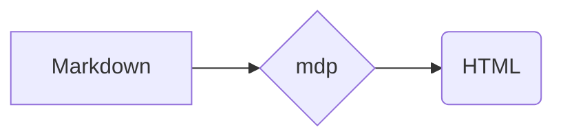

# GitHub Additions

## Footnotes

A claim[^1] and another.[^note]

[^1]: The first footnote.
[^note]: A named footnote, with `code`.

## Alerts

> [!NOTE]
> Useful information.

> [!tip]
> Lowercase markers work too.

> [!WARNING]
> **Bold** warning
> over two lines.

> [!CAUTION]

> [!NOPE]
> Unknown types stay plain quotes.

> [!NOTE] Text on the marker line
> keeps it a plain quote.

## Emoji

:rocket: :+1: :tada: and :not-an-emoji:.

## Math

Inline $e^{i\pi} + 1 = 0$, with backticks $`\sqrt{2}`$, and display:

$$
\sum_{n=1}^\infty \frac{1}{n^2} = \frac{\pi^2}{6}
$$

Prices like $5 and $10 stay text, as do $ spaced $ and escaped \$x\$.
HTML in math is escaped: $a<b$ and $x > y$.

```math
\int_0^1 x^2 \, dx = \frac{1}{3}
```

## Mermaid



## HTML GitHub allows

<p align="center"></p>

<picture>
  <source media="(prefers-color-scheme: dark)" srcset="dot.png">
  
</picture>


## Links to files

[Another note](other.md#a-section), [a folder](docs/), and [a page
anchor](#footnotes).
