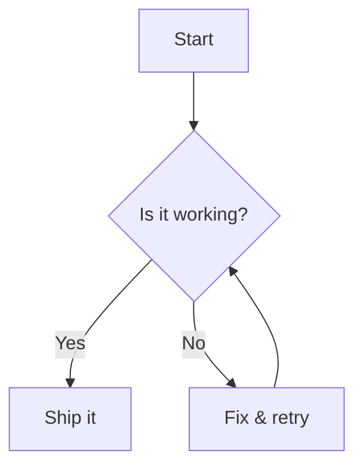
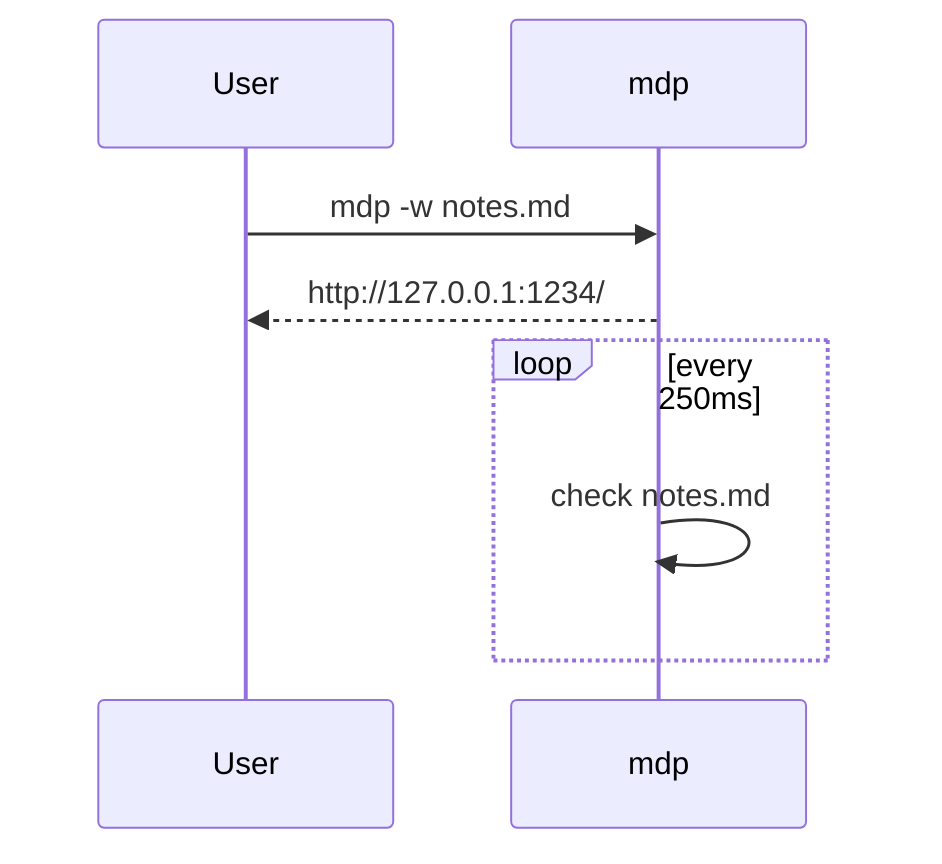
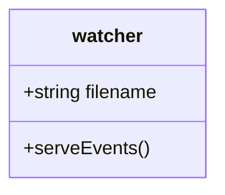
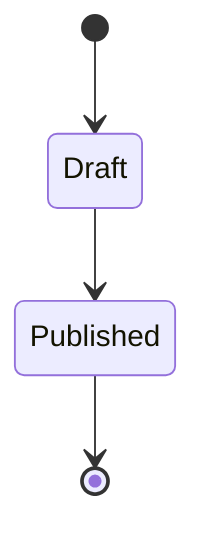
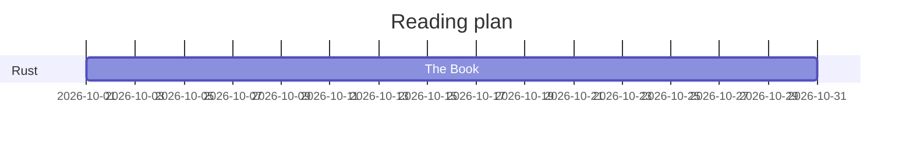
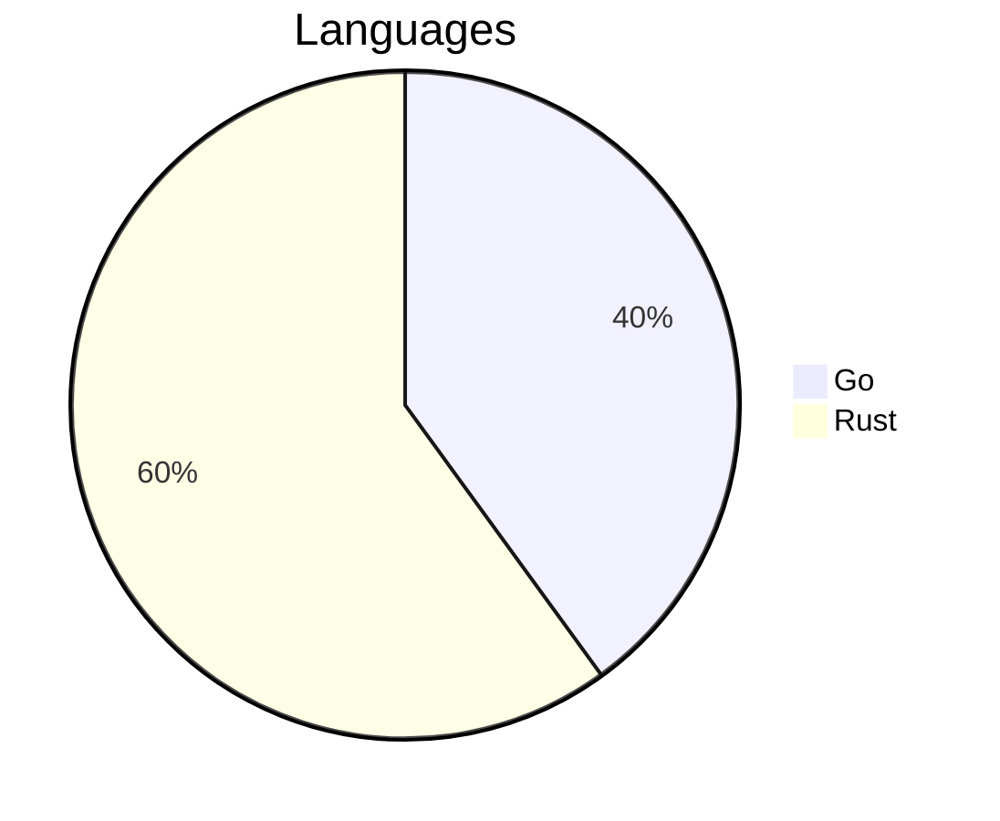

# Mermaid Diagrams

## Flowchart



## Sequence



## Class diagram



## State, Gantt, and pie







## Not diagrams

A `mermaid` word in code, and a block in another language:

```text
graph LR
  A --> B
```

In a list:

1. Step one:

   ```mermaid
   graph LR
     X --> Y
   ```
